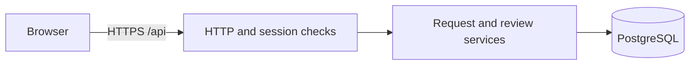
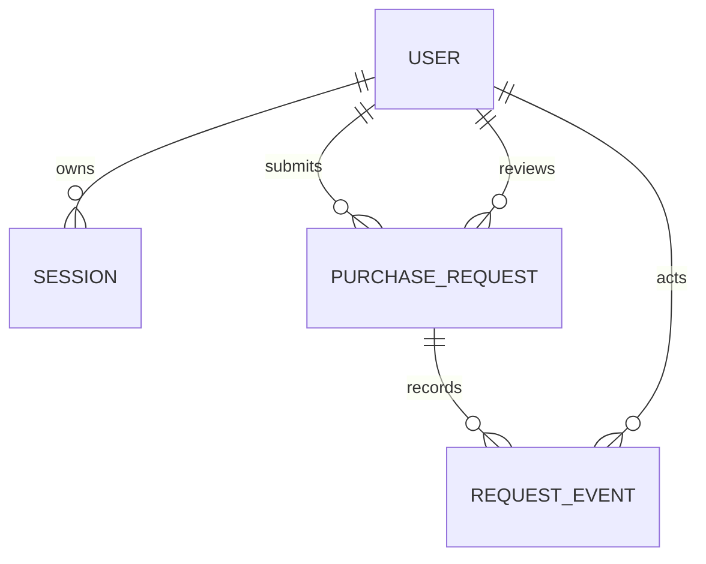

# System-Level Software Design — Sprint 1

Version 0.2, review baseline. Sources: Deliverable 1 §4.1 Parts B–E and [SRS](srs.md). Feature-level behavior and verification are in the [contracts](sprints/sprint-1/contracts.md). Decisions D-01–D-06 follow the staged SRS. The v0.2 stack and interface choices are specified below and take effect after review.

## Architecture and deployment

Stack: TypeScript, React 19 with Vite 7 for the browser, Node.js 22 with Express 5 for HTTP, PostgreSQL 16, and Prisma 6 for schema and migrations. Lock exact package versions when initializing the application. Serve the production browser bundle and JSON API on one origin. HTTP handlers parse inputs and resolve sessions; feature services apply authorization and transition rules; database adapters enforce persistence and constraints. The browser never connects directly to PostgreSQL.

Use versioned migrations and synthetic accounts for local setup. Keep database connection and session settings server-side in environment variables; publish only example values. Tests run against an isolated database with deterministic fixtures. Future deployment uses HTTPS, separate runtime credentials and a persistent managed database; run migrations as a controlled release step before traffic, then check login and the full purchase journey. Containerization, hosted deployment and CI completion belong to later work.

## Data and access

User has an opaque ID, unique login, password hash and one role (Requester or Reviewer). Session stores an opaque token digest, user FK and expiry. Preset reviewer mapping identifies at most one reviewer per requester. A request stores its immutable requester and reviewer FKs, title, purpose, exact amount in integer satang, status and creation time. Event stores request FK, actor FK, event type, time and optional reason. Index requester/reviewer list lookups and history by request; disallow equal requester and reviewer IDs. Request creation and its submission event share a transaction. The decision uses a conditional status update from SUBMITTED and inserts its event in the same transaction; a lost race writes no event.

| Operation | Requester | Reviewer |
| --- | --- | --- |
| Submit | Own identity from session | Forbidden |
| List/detail/history | Own requests | Assigned requests |
| Approve/reject | Forbidden | Assigned submitted request, never own |

Use consistent JSON errors containing a stable code and safe message, with per-field validation details where applicable. Use UTC timestamps and stable opaque IDs. Show loading, empty, retry, validation and success states in the browser; provide keyboard operation, visible focus, labels, text status and field-associated errors. Resolve roles and scope on every server operation; UI controls reflect those checks.

See the [feature inventory](features.md) and [requirements traceability](traceability.md).

## Three-sprint plan

1. Sprint 1 delivers a locally runnable purchase request from seeded login through a persisted reviewer decision. Completion requires the contracts, end-to-end journey, negative tests and reviewed integration evidence.
2. Sprint 2 adds return/revise/resubmit and list filters (F-04–05) after the Sprint 1 transition rules and ownership checks are stable. Demonstrate a revised submission and scoped filtering.
3. Sprint 3 adds decision summaries (F-06) and hardens the accepted workflow. Verify that reports respect role and ownership rules and that the release can be reproduced.
